  <a href="./README.md">English</a> | <a href="./README.es.md"><strong>Español</strong></a>

  

  <strong>Computación cuántica · Tensor networks · Software científico · IA aplicada</strong>

  Coordinador de la Unidad de Computación Cuántica en ITCL · Doctorando en la Universidad de Burgos · España

  
  
  
  

  <a href="#software">Software</a> ·
  <a href="#research">Investigación</a> ·
  <a href="#engineering">IA aplicada e ingeniería</a> ·
  <a href="#teaching">Docencia</a> ·
  <a href="#projects">Proyectos seleccionados</a>

## Sobre mí

Soy **Alejandro Mata Ali**, investigador y desarrollador de software científico especializado en **tensor networks, algoritmos cuánticos y quantum-inspired, optimización combinatoria y métodos numéricos**. Coordino la Unidad de Computación Cuántica de ITCL y realizo investigación doctoral en la Universidad de Burgos.

Mi actividad combina investigación e implementación: desarrollo de herramientas científicas reproducibles, evaluación de soluciones prácticas, coordinación técnica de I+D y comunicación de conocimientos complejos. También trabajo en **IA aplicada**, especialmente en arquitecturas de conocimiento e instrucciones, automatización y flujos con revisión humana. Se trata de ingeniería e integración aplicada, no de investigación fundamental sobre modelos fundacionales.

## Software científico mantenido

Tres librerías Python de código abierto constituyen una parte central de mi trabajo. Están publicadas en PyPI y se mantienen como herramientas reutilizables, no solo como demostraciones de investigación.

- **[Tensor-Network-Visualization](https://github.com/DOKOS-TAYOS/Tensor-Network-Visualization)**: visualización 2D/3D, inspección y depuración de tensor networks en distintos ecosistemas de Python científico.
- **[Tensor-Network-Editor](https://github.com/DOKOS-TAYOS/Tensor-Network-Editor)**: diseño visual interactivo de tensor networks y generación de código Python para varios backends.
- **[quantum-circuit-drawer](https://github.com/DOKOS-TAYOS/quantum-circuit-drawer)**: dibujo, análisis, comparación y exportación de circuitos cuánticos y sus resultados.

**Investigación relacionada:** [*Visual-to-Code Authoring, Tensor-Network Debugging, and Quantum-Circuit Inspection Tools in Python*](https://arxiv.org/abs/2606.08760) (2026, preprint en arXiv), que presenta esta familia de herramientas.

[Ver mis paquetes Python publicados en PyPI](https://pypi.org/user/DOKOS-TAYOS/).

## Investigación y publicaciones

Mi investigación se centra en métodos con tensor networks, algoritmos y simulación cuántica, optimización discreta (incluyendo QUBO, QUDO y Tensor QUDO) y computación científica eficiente. Algunos trabajos recientes:

- **[Simulating the finite-resolution HHL spectral filter with tensor networks and qudits](https://doi.org/10.1088/1402-4896/aea197)**. *Physica Scripta*, publicado en septiembre de 2026. [Versión anterior en arXiv](https://arxiv.org/abs/2309.05290).
- **[Análisis comparativo de QAOA mediante la formulación Tensor QUDO para una variante del TSP aplicable a motores de búsqueda de viajes](https://revistas.unlp.edu.ar/JAIIO/article/view/22473)**. *JAIIO / ASQC 2026*, publicado en octubre de 2026. [Software de investigación](https://github.com/DOKOS-TAYOS/Hotels-TSP-Tensor-QUDO) desarrollado conjuntamente.
- **[Visual-to-Code Authoring, Tensor-Network Debugging, and Quantum-Circuit Inspection Tools in Python](https://arxiv.org/abs/2606.08760)**. 2026, **preprint** sobre las tres librerías anteriores.

Otras implementaciones de investigación abarcan el problema del viajante, planificación de tareas, inicialización tensorizada, HHL, QAOA y formulaciones estructuradas QUBO/QUDO. **Se distingue explícitamente entre preprints y publicaciones revisadas por pares** en los registros enlazados.

Para consultar el conjunto de publicaciones: [Google Scholar](https://scholar.google.com/citations?user=H2wPwc8AAAAJ) y [ORCID](https://orcid.org/0009-0006-7289-8827).

## IA aplicada e ingeniería técnica

Además de la algoritmia científica, trabajo en procesos de ingeniería aplicada: sistemas estructurados de conocimiento e instrucciones, recuperación indexada de contexto, desarrollo asistido por IA, automatización, comprobaciones deterministas y revisión humana. También participo en coordinación técnica, estudios de viabilidad, prototipado y transferencia en proyectos de I+D.

- **[knotbase](https://github.com/DOKOS-TAYOS/knotbase)**: piloto público para distribuir una selección de workflows de instrucciones indexadas. Es **experimental**, no un producto validado de extremo a extremo.
- **Herramientas Python científicas**: las librerías anteriores ejemplifican mi trabajo en interfaces reutilizables, inspección, documentación y desarrollo reproducible.

Los proyectos privados, trabajos con clientes y sistemas internos no se presentan aquí como productos de software públicos.

## Docencia y divulgación científica

La docencia y la comunicación pública forman parte continuada de mi actividad, junto con la investigación y el desarrollo de software.

- **[When Physics](https://www.youtube.com/@whenphysics)**: cursos, materiales educativos y explicaciones públicas sobre física, matemáticas, computación cuántica y áreas relacionadas.
- **[Curso de algoritmos cuánticos con Qiskit](https://github.com/DOKOS-TAYOS/Curso_Algoritmos_Cuanticos_Qiskit)**: curso finalizado y archivado, con teoría y notebooks prácticos.
- **[Taller de QAOA](https://github.com/DOKOS-TAYOS/QAOA_Foro_Nuevos_Paradigmas)**: materiales archivados sobre formulaciones QUBO/Ising y QAOA.
- **[Artículos técnicos](https://medium.com/@alejandro-mata-ali)**: textos y explicaciones para públicos con distinta formación.

## Proyectos seleccionados

Esta es una **selección editorial**, no un inventario exhaustivo ni actualizado automáticamente. Algunas implementaciones de investigación y aplicaciones finalizadas están archivadas deliberadamente; aun así, pueden servir como referencias reproducibles.

<strong>Implementaciones con tensor networks e investigación cuántica</strong>

- [Travelling Salesman Problem with Tensor Networks](https://github.com/DOKOS-TAYOS/Traveling_Salesman_Problem_with_Tensor_Networks): formulaciones del TSP, experimentos y comparativas. [Preprint](https://arxiv.org/abs/2311.14344).
- [HHL with Tensor Networks](https://github.com/DOKOS-TAYOS/Tensor_Networks_HHL_algorithm): simulación tensorial de un filtro espectral HHL (archivado).
- [Linear-chain QUBO, QUDO and Tensor QUDO](https://github.com/DOKOS-TAYOS/Lineal_chain_QUBO_QUDO_TensorQUDO_Solver_with_Tensor_Networks): problemas de optimización estructurada.
- [Efficient Initialization of Tensor Networks](https://github.com/DOKOS-TAYOS/Efficient_Initialization_Tensor_Networks): métodos de inicialización finita y normalización.
- [Task Scheduler with Tensor Networks](https://github.com/DOKOS-TAYOS/Task_Scheduler_with_Tensor_Networks): experimentos de planificación con restricciones.
- [HoLCUs QAOA](https://github.com/DOKOS-TAYOS/HoLCUs_QAOA): investigación sobre QAOA con Hadamard/LCU.
- [Hotels-TSP-Tensor-QUDO](https://github.com/DOKOS-TAYOS/Hotels-TSP-Tensor-QUDO): experimentos con QUBO, Tensor QUDO y QAOA; desarrollado conjuntamente con Adriano Lusso (archivado).

<strong>Aplicaciones científicas, herramientas educativas y trabajos anteriores</strong>

- [RegressionLab](https://github.com/DOKOS-TAYOS/RegressionLab): ajuste de curvas, incertidumbre y visualización científica (finalizado y archivado).
- [DifferentialLab](https://github.com/DOKOS-TAYOS/DifferentialLab): flujos para EDO, problemas de contorno, ecuaciones en diferencias y EDP (finalizado y archivado).
- [Mini-Qiskit with Tensor Networks](https://github.com/DOKOS-TAYOS/Mini-Qiskit_with_Tensor_Networks): simulación educativa de circuitos con vectores de estado y tensor networks (archivado).
- [Shor Algorithm](https://github.com/DOKOS-TAYOS/Shor-Algorithm): implementaciones educativas que conservan la atribución de código de terceros en el repositorio (archivado).
- [Experimento FPUT](https://github.com/DOKOS-TAYOS/Experimento-FPUT): simulación numérica en Fortran y Python (archivado).
- [Modelo Skyrme-rho con aproximación instantón](https://github.com/DOKOS-TAYOS/Skyrme-rho-with-6-term-in-instanton-app): investigación simbólica y numérica vinculada a mi TFM (archivado).
- [desktop_config](https://github.com/DOKOS-TAYOS/desktop_config): aplicación Streamlit para planificar el escritorio, la iluminación natural y el deslumbramiento (archivado).

## Herramientas técnicas y enlaces

**Investigación y desarrollo:** Python, NumPy, SciPy, PyTorch, Qiskit, CUDA-Q, librerías de tensor networks, Matplotlib, Jupyter y Streamlit.

**Más información:** [Repositorios públicos de GitHub](https://github.com/DOKOS-TAYOS?tab=repositories) · [PyPI](https://pypi.org/user/DOKOS-TAYOS/) · [Google Scholar](https://scholar.google.com/citations?user=H2wPwc8AAAAJ) · [ORCID](https://orcid.org/0009-0006-7289-8827) · [LinkedIn](https://www.linkedin.com/in/mata-ali-alejandro/).

<em>Investigación, software reutilizable, coordinación técnica y educación científica.</em>

