  <a href="./README.md"><strong>English</strong></a> | <a href="./README.es.md">Español</a>

  

  <strong>Quantum computing · Tensor networks · Scientific software · Applied AI</strong>

  Quantum Computing Unit Coordinator at ITCL · Doctoral researcher at the University of Burgos · Spain

  
  
  
  

  <a href="#software">Software</a> ·
  <a href="#research">Research</a> ·
  <a href="#engineering">Applied AI & engineering</a> ·
  <a href="#teaching">Teaching</a> ·
  <a href="#projects">Selected projects</a>

## About

I am **Alejandro Mata Ali**, a researcher and scientific software developer working across **tensor networks, quantum and quantum-inspired algorithms, combinatorial optimization, and numerical methods**. I coordinate ITCL's Quantum Computing Unit and pursue doctoral research at the University of Burgos.

My work combines research and implementation: developing reproducible scientific tools, evaluating practical approaches, coordinating technical R&D, and communicating complex ideas. I also work on **applied AI**, particularly knowledge and instruction architectures, automation, and human-reviewable workflows. This is applied engineering and integration work, not fundamental research into foundation models.

## Maintained scientific software

Three open-source Python libraries are a central part of my work. They are published on PyPI and maintained as reusable tools rather than one-off research demos.

- **[Tensor-Network-Visualization](https://github.com/DOKOS-TAYOS/Tensor-Network-Visualization)**: 2D/3D visualization, inspection and debugging of tensor networks across scientific Python ecosystems.
- **[Tensor-Network-Editor](https://github.com/DOKOS-TAYOS/Tensor-Network-Editor)**: interactive visual authoring of tensor networks, with Python code generation for multiple backends.
- **[quantum-circuit-drawer](https://github.com/DOKOS-TAYOS/quantum-circuit-drawer)**: drawing, analysis, comparison and export of quantum-circuit representations and results.

**Related research:** [*Visual-to-Code Authoring, Tensor-Network Debugging, and Quantum-Circuit Inspection Tools in Python*](https://arxiv.org/abs/2606.08760) (2026, arXiv preprint), which presents this family of tools.

[Browse my published Python packages on PyPI](https://pypi.org/user/DOKOS-TAYOS/).

## Research and publications

My research centres on tensor-network methods, quantum algorithms and simulation, discrete optimization (including QUBO, QUDO and Tensor QUDO), and efficient scientific computation. Selected recent work:

- **[Simulating the finite-resolution HHL spectral filter with tensor networks and qudits](https://doi.org/10.1088/1402-4896/aea197)**. *Physica Scripta*, published September 2026. [Earlier arXiv version](https://arxiv.org/abs/2309.05290).
- **[Análisis comparativo de QAOA mediante la formulación Tensor QUDO para una variante del TSP aplicable a motores de búsqueda de viajes](https://revistas.unlp.edu.ar/JAIIO/article/view/22473)**. *JAIIO / ASQC 2026*, published October 2026. Related jointly developed [research software](https://github.com/DOKOS-TAYOS/Hotels-TSP-Tensor-QUDO).
- **[Visual-to-Code Authoring, Tensor-Network Debugging, and Quantum-Circuit Inspection Tools in Python](https://arxiv.org/abs/2606.08760)**. 2026, **preprint**, covering the three libraries above.

Other research implementations cover the travelling salesman problem, task scheduling, tensorized initialization, HHL, QAOA, and structured QUBO/QUDO formulations. **Preprints and peer-reviewed publications are distinguished explicitly** in the linked records.

For my broader publication record, see [Google Scholar](https://scholar.google.com/citations?user=H2wPwc8AAAAJ) or [ORCID](https://orcid.org/0009-0006-7289-8827).

## Applied AI and technical engineering

Beyond scientific algorithms, I work on practical engineering processes: structured knowledge and instruction systems, indexed context retrieval, AI-assisted development, workflow automation, deterministic checks, and human review. I also contribute to technical coordination, feasibility assessment, prototyping, and knowledge transfer in R&D settings.

- **[knotbase](https://github.com/DOKOS-TAYOS/knotbase)**: a public pilot for distributing selected, indexed instruction workflows. It is **experimental**, not a fully validated end-to-end product.
- **Scientific Python tooling**: the maintained libraries above are examples of my focus on reusable interfaces, inspectability, documentation, and reproducible development.

Private research, client work, and internal systems are intentionally not represented here as public software releases.

## Teaching and science communication

Teaching and public communication are ongoing parts of my work, alongside research and software development.

- **[When Physics](https://www.youtube.com/@whenphysics)**: courses, educational material and public explanations about physics, mathematics, quantum computing and related topics.
- **[Quantum algorithms with Qiskit](https://github.com/DOKOS-TAYOS/Curso_Algoritmos_Cuanticos_Qiskit)**: a completed, archived course with theory and practical notebooks.
- **[QAOA workshop](https://github.com/DOKOS-TAYOS/QAOA_Foro_Nuevos_Paradigmas)**: archived workshop materials on QUBO/Ising formulations and QAOA.
- **[Technical writing](https://medium.com/@alejandro-mata-ali)**: articles and explanations for audiences with different backgrounds.

## Selected projects

This is a **curated selection**, not an exhaustive or automatically updated inventory. Some research implementations and completed applications are intentionally archived; an archived repository can still be useful as a reproducible reference.

<strong>Tensor-network and quantum research implementations</strong>

- [Travelling Salesman Problem with Tensor Networks](https://github.com/DOKOS-TAYOS/Traveling_Salesman_Problem_with_Tensor_Networks): TSP formulations, experiments and comparisons. [Preprint](https://arxiv.org/abs/2311.14344).
- [HHL with Tensor Networks](https://github.com/DOKOS-TAYOS/Tensor_Networks_HHL_algorithm): tensor-network simulation of an HHL spectral filter (archived).
- [Linear-chain QUBO, QUDO and Tensor QUDO](https://github.com/DOKOS-TAYOS/Lineal_chain_QUBO_QUDO_TensorQUDO_Solver_with_Tensor_Networks): structured optimization problems.
- [Efficient Initialization of Tensor Networks](https://github.com/DOKOS-TAYOS/Efficient_Initialization_Tensor_Networks): finite normalization and initialization methods.
- [Task Scheduler with Tensor Networks](https://github.com/DOKOS-TAYOS/Task_Scheduler_with_Tensor_Networks): constrained scheduling experiments.
- [HoLCUs QAOA](https://github.com/DOKOS-TAYOS/HoLCUs_QAOA): Hadamard/LCU-based QAOA research.
- [Hotels-TSP-Tensor-QUDO](https://github.com/DOKOS-TAYOS/Hotels-TSP-Tensor-QUDO): QUBO, Tensor QUDO and QAOA experiments; jointly developed with Adriano Lusso (archived).

<strong>Scientific applications, teaching tools and earlier work</strong>

- [RegressionLab](https://github.com/DOKOS-TAYOS/RegressionLab): curve fitting, uncertainty analysis and scientific visualization (completed and archived).
- [DifferentialLab](https://github.com/DOKOS-TAYOS/DifferentialLab): ODE, BVP, difference-equation and PDE workflows (completed and archived).
- [Mini-Qiskit with Tensor Networks](https://github.com/DOKOS-TAYOS/Mini-Qiskit_with_Tensor_Networks): educational quantum-circuit simulation with statevectors and tensor networks (archived).
- [Shor Algorithm](https://github.com/DOKOS-TAYOS/Shor-Algorithm): educational implementations, with third-party code attribution retained in the repository (archived).
- [FPUT experiment](https://github.com/DOKOS-TAYOS/Experimento-FPUT): numerical simulation in Fortran and Python (archived).
- [Skyrme-rho with an instanton approximation](https://github.com/DOKOS-TAYOS/Skyrme-rho-with-6-term-in-instanton-app): symbolic and numerical research connected to my master's thesis (archived).
- [desktop_config](https://github.com/DOKOS-TAYOS/desktop_config): a Streamlit application for desktop layout, daylight and glare assessment (archived).

## Technical toolkit and links

**Research and software:** Python, NumPy, SciPy, PyTorch, Qiskit, CUDA-Q, tensor-network libraries, Matplotlib, Jupyter and Streamlit.

**Find more:** [Public GitHub repositories](https://github.com/DOKOS-TAYOS?tab=repositories) · [PyPI](https://pypi.org/user/DOKOS-TAYOS/) · [Google Scholar](https://scholar.google.com/citations?user=H2wPwc8AAAAJ) · [ORCID](https://orcid.org/0009-0006-7289-8827) · [LinkedIn](https://www.linkedin.com/in/mata-ali-alejandro/).

<em>Research, reusable software, technical coordination and scientific education.</em>

